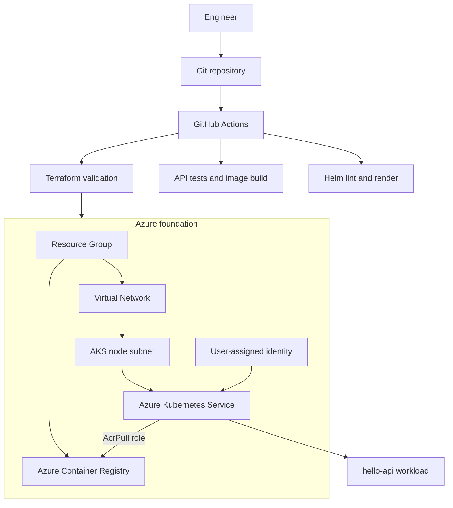

# Kaviont Platform

[](https://github.com/mohamadjaafri/kaviont-platform/actions/workflows/ci.yml)

**Cloud Infrastructure. Automation. Engineering.**

Kaviont is an independent engineering reference project for building a repeatable cloud-native platform on Microsoft Azure. The first increment provisions an Azure foundation, AKS, Azure Container Registry, and a sample workload delivery path.

> Status: early reference implementation. Kaviont is a working project name, not a cleared or registered product mark. This repository is an independent portfolio project and is not affiliated with any employer or customer.

## Engineering scope

- Modular Infrastructure as Code with Terraform.
- Azure networking with dedicated AKS and reserved private-endpoint subnets.
- AKS with Azure RBAC, managed identity, OIDC, and Workload Identity support.
- Azure CNI Overlay with Cilium network policy/data plane.
- Azure Container Registry with admin credentials disabled and scoped `AcrPull` assignment.
- FastAPI sample workload packaged as a non-root container.
- Helm deployment with health probes, resource limits, autoscaling, PodDisruptionBudget, and NetworkPolicy.
- GitHub Actions checks for Terraform, Helm, Python tests, and image builds.

## Architecture



Detailed design: [Architecture](docs/architecture.md), [ADR 0001](docs/decisions/0001-azure-aks-foundation.md), [Security and cost](docs/security-and-cost.md), and [Provisioning runbook](docs/runbooks/provision-and-destroy.md).

## Repository layout

```text
.github/                 CI and dependency updates
charts/hello-api/        Helm chart
infrastructure/terraform/ Reusable Terraform modules and dev environment
docs/                    Architecture, ADRs, and runbooks
workloads/hello-api/     FastAPI service, tests, and Dockerfile
Makefile                 Local validation commands
```

## Validate locally

Prerequisites: Terraform 1.11.x, Azure CLI, Helm 3.x, Docker, and Python 3.12.

From the repository root:

```bash
make fmt-check
make terraform-validate
make app-test
make helm-check
make image-build
```

These commands validate the source and build a local image. They do not provision Azure resources.

## Provision the development environment

1. Authenticate with Azure and select a non-production subscription:

   ```bash
   az login
   az account set --subscription <subscription-id>
   export ARM_SUBSCRIPTION_ID=<subscription-id>
   ```

2. Create the variable file:

   ```bash
   cp infrastructure/terraform/environments/dev/terraform.tfvars.example infrastructure/terraform/environments/dev/terraform.tfvars
   ```

3. Set a unique 4-8 character lowercase alphanumeric `unique_suffix` for ACR. Replace the documentation-only API-server CIDR with your fixed public egress IP in `/32` notation. Do not apply the sample CIDR to a real environment.

4. Initialize and inspect the plan:

   ```bash
   cd infrastructure/terraform/environments/dev
   terraform init
   terraform validate
   terraform plan -out=tfplan
   ```

5. Apply only after reviewing the plan:

   ```bash
   terraform apply tfplan
   ```

6. Connect to AKS:

   ```bash
   az aks get-credentials --resource-group <resource-group-name> --name <aks-name>
   kubectl get nodes
   ```

## Deploy the sample workload

Build and push the image to the provisioned ACR, then install the chart:

```bash
az acr login --name <acr-name>
docker build -t <acr-login-server>/hello-api:0.1.0 workloads/hello-api
docker push <acr-login-server>/hello-api:0.1.0
helm upgrade --install hello-api charts/hello-api \
  --namespace demo --create-namespace \
  --set image.repository=<acr-login-server>/hello-api \
  --set image.tag=0.1.0
kubectl rollout status deployment/hello-api -n demo
```

The chart creates a ClusterIP service. Ingress and external exposure are intentionally outside the first increment.

## Clean up

```bash
helm uninstall hello-api -n demo
kubectl delete namespace demo
cd infrastructure/terraform/environments/dev
terraform plan -destroy -out=destroy.tfplan
terraform apply destroy.tfplan
```

Review the destroy plan before confirming. Terraform state and plan files must never be committed.

## Security and operational boundaries

The first increment uses managed identities, Azure RBAC, a scoped API-server CIDR allowlist, disabled ACR admin credentials, non-root containers, and resource bounds. It does **not** yet implement private AKS/ACR endpoints, remote Terraform state, policy-as-code enforcement, image signing, centralized secrets delivery, or production HA. These are roadmap items, not current capabilities.

AKS nodes, disks, load balancers, registry storage, and network egress can incur charges while the environment exists. Review current regional pricing and destroy unused environments.

## Roadmap

- Remote Terraform state in Azure Storage with Entra ID authentication and locking.
- Private AKS API endpoint, private DNS, and private ACR connectivity.
- Key Vault CSI integration with Workload Identity.
- Managed Prometheus, Grafana dashboards, and OpenTelemetry.
- GitOps bootstrap with Argo CD.
- Policy checks, image scanning, and container image signing.

## Contributing and license

See [CONTRIBUTING.md](CONTRIBUTING.md). The project is licensed under MIT. See [LICENSE](LICENSE).

## Technical references

- [AzureRM AKS resource](https://registry.terraform.io/providers/hashicorp/azurerm/4.59.0/docs/resources/kubernetes_cluster)
- [Microsoft Entra Workload ID on AKS](https://learn.microsoft.com/en-us/azure/aks/workload-identity-overview)
- [Provision AKS with Terraform](https://developer.hashicorp.com/terraform/tutorials/kubernetes/aks)
